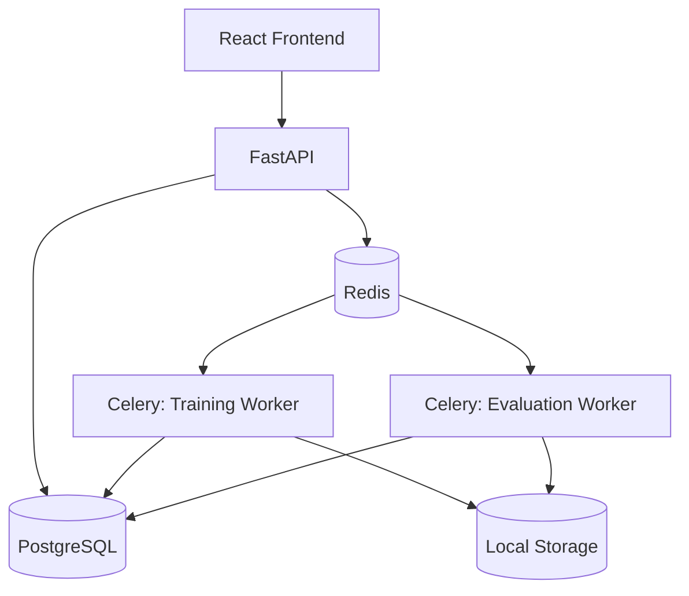
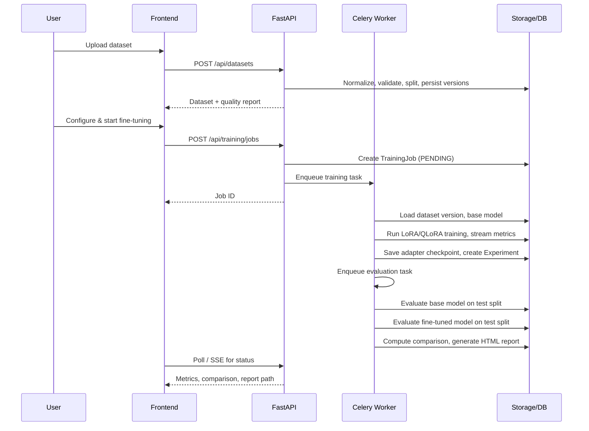

# Architecture

## Overview

## Why background workers

Fine-tuning and evaluation are long-running, CPU/GPU-bound operations that
can take anywhere from seconds (tiny CPU demo) to hours (full GPU LoRA
run). FastAPI request handlers must never block on this kind of work, so:

1. `POST /api/training/jobs` creates a `TrainingJob` row (status `PENDING`)
   and enqueues a Celery task, then returns immediately.
2. A Celery worker process (`app.workers.tasks.run_training_job_task`)
   picks up the job, updates its status as it progresses, and streams
   real metrics into the `training_metrics` table as training runs.
3. On completion, the worker automatically creates an `Experiment`,
   registers a `ModelVersion` for the fine-tuned adapter, and enqueues an
   evaluation task that evaluates both the base and fine-tuned model on
   the same held-out test split.
4. The evaluation worker generates an HTML report and stores it (and the
   model artifact) as `Artifact` rows.

The frontend polls `GET /api/training/jobs/{id}` and consumes a
Server-Sent Events stream (`GET /api/training/jobs/{id}/stream`) for
near-real-time updates without needing a separate WebSocket server.

## Data flow: dataset -> training -> evaluation -> report

## Module boundaries

- `app/api/` — HTTP layer only: request/response validation, auth, delegating to services.
- `app/services/` — orchestration/business logic (dataset ingestion, job creation, evaluation orchestration, report generation).
- `app/ml/` — pure(ish) ML logic with no FastAPI/DB coupling where possible: dataset loading/validation, training, evaluation metrics, inference.
- `app/workers/` — Celery tasks that call into `app/services` and `app/ml`.
- `app/models/` — SQLAlchemy ORM models (the source of truth for schema).
- `app/schemas/` — Pydantic request/response contracts.

This separation means the training/evaluation code in `app/ml` can be
(and is) unit-tested and even run standalone via `scripts/demo.py`
without spinning up FastAPI, Postgres, or Redis at all.
